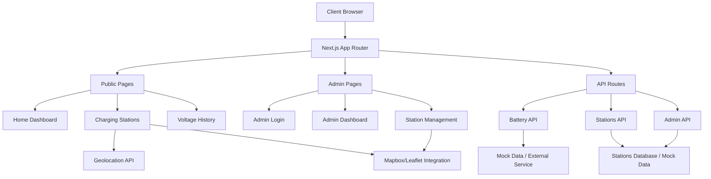

# Design Document

## Overview

The EV Battery Monitoring and Smart Charging Station Recommender System is a full-stack Next.js application that provides real-time battery monitoring and intelligent charging station recommendations. The system leverages modern web technologies including React Server Components, Tailwind CSS, Shadcn/UI components, and integrates with mapping services to deliver a responsive, user-friendly experience across all devices.

The application follows a clean architecture pattern with clear separation between public user features and administrative functions, utilizing Next.js App Router for optimal performance and SEO. It now supports **multiple administrators**, each of whom can securely manage their own charging stations with full ownership tracking.

## Architecture

### High-Level Architecture



### Technology Stack

- **Frontend Framework**: Next.js 15 with App Router
- **Styling**: Tailwind CSS 4 with CSS Variables
- **UI Components**: Shadcn/UI (Radix UI primitives)
- **Icons**: Lucide React
- **Charts**: Recharts 2.15.4
- **Forms**: React Hook Form with Zod validation
- **Maps**: Mapbox GL JS (primary) with Leaflet fallback
- **State Management**: React Server Components + Client Components
- **Notifications**: Sonner for toast notifications
- **Authentication**: Utilize NextAuth for storing normal users and admins
- **Database**: MongoDB for not only storing users and admins but also charging station data

### Project Structure

```
app/
├── (auth)/                   # Authentication routes group
│   ├── login/
│   │   └── page.tsx          # User login
│   ├── register/
│   │   └── page.tsx          # User registration
│   └── register-device/
│       └── page.tsx          # EV/Device registration
├── (dashboard)/              # Protected user routes
│   ├── page.tsx              # Home dashboard (protected)
│   ├── stations/             # Charging stations
│   │   └── page.tsx
│   └── history/              # Voltage history
│       └── page.tsx
├── admin/                    # Admin routes
│   ├── login/
│   │   └── page.tsx
│   ├── dashboard/
│   │   └── page.tsx
│   └── stations/
│       ├── page.tsx          # Station list
│       └── add/
│           └── page.tsx      # Add station form
├── api/                      # API routes
│   ├── auth/                 # NextAuth.js endpoints
│   │   └── [...nextauth]/
│   │       └── route.ts      # NextAuth.js configuration
│   ├── user/                 # User management
│   │   ├── profile/
│   │   │   └── route.ts
│   │   └── devices/
│   │       └── route.ts      # Link/unlink devices
│   ├── voltage/
│   │   └── route.ts          # Get voltage data (requires auth)
│   ├── voltage-report/
│   │   └── route.ts          # ESP32 voltage reporting (no auth)
│   ├── voltage-history/
│   │   └── route.ts          # User-specific history
│   ├── stations/
│   │   └── nearby/
│   │       └── route.ts
│   └── admin/
│       └── stations/
│           └── route.ts
├── globals.css
└── layout.tsx

components/
├── ui/                       # Shadcn/UI components
├── auth/                     # Authentication components
│   ├── signin-form.tsx       # NextAuth signin form
│   ├── signup-form.tsx       # Custom registration form
│   ├── device-registration-form.tsx
│   └── auth-provider.tsx     # NextAuth session provider
├── battery/                  # Battery-specific components
│   ├── voltage-display.tsx
│   ├── low-battery-alert.tsx
│   └── voltage-chart.tsx
├── stations/                 # Station-related components
│   ├── station-list.tsx
│   ├── station-card.tsx
│   ├── station-map.tsx
│   └── station-filters.tsx
├── admin/                    # Admin components
│   ├── station-table.tsx
│   ├── add-station-form.tsx
│   └── location-picker.tsx
└── layout/                   # Layout components
    ├── navigation.tsx
    ├── mobile-nav.tsx
    ├── user-nav.tsx          # User profile dropdown
    └── admin-nav.tsx

lib/
├── utils.ts                  # Utility functions
├── api.ts                    # API client functions
├── mock-data.ts              # Mock data for development
├── geolocation.ts            # Geolocation utilities
├── auth.ts                   # NextAuth configuration
├── auth-options.ts           # NextAuth providers and callbacks
├── validation.ts             # Zod schemas
└── battery-utils.ts          # Battery calculation utilities

types/
├── auth.ts                   # Authentication types
├── user.ts                   # User and device types
├── battery.ts                # Battery-related types
├── station.ts                # Station-related types
└── api.ts                    # API response types
```

## Components and Interfaces

### Core Data Types

```typescript
// User & Authentication Types (NextAuth.js compatible)
interface User {
  id: string;
  email: string;
  name: string;
  password: string; // Hashed password
  role: 'user' | 'admin';
  createdAt: Date;
  devices: UserDevice[];
}

interface UserDevice {
  id: string;
  userId: string;
  vehicleId: string; // Unique ESP32 device ID
  deviceName: string; // User-friendly name
  isActive: boolean;
  registeredAt: Date;
}

// NextAuth.js Session Types
declare module "next-auth" {
  interface Session {
    user: {
      id: string;
      email: string;
      name: string;
      role: 'user' | 'admin';
    }
  }
  
  interface User {
    id: string;
    email: string;
    name: string;
    role: 'user' | 'admin';
  }
}

declare module "next-auth/jwt" {
  interface JWT {
    id: string;
    role: 'user' | 'admin';
  }
}

// Battery Types
interface BatteryVoltage {
  id: string;        // Unique reading ID
  voltage: number;   // Current voltage reading
  percentage: number; // Calculated battery percentage (0-100)
  timestamp: Date;   // When reading was taken
  status: 'normal' | 'low' | 'critical';
  vehicleId: string; // Links to UserDevice.vehicleId
  userId: string;    // Links to User.id for quick filtering
  deviceId: string;  // Links to UserDevice.id
}

interface VoltageHistory {
  readings: BatteryVoltage[];
  period: 'day' | 'week' | 'month';
  vehicleId: string;
  deviceInfo: {
    deviceName: string;
    vehicleId: string;
  };
}

// Station Types
interface ChargingStation {
  id: string;
  name: string;
  latitude: number;
  longitude: number;
  pricePerKwh: number;
  queueLength: number;
  adminId: string; // 👈 Identifies which admin owns/added this station
  distance?: number; // Calculated based on user location
  amenities?: string[];
  operatingHours?: {
    open: string;
    close: string;
  };
  createdAt: Date;
  updatedAt: Date;
}

interface StationSearchParams {
  latitude: number;
  longitude: number;
  radius?: number; // in kilometers
  maxResults?: number;
}

// Admin Types
interface AdminUser {
  id: string;
  username: string;
  email?: string
  role: 'admin';
  createdAt: Date;
}

interface StationFormData {
  name: string;
  latitude: number;
  longitude: number;
  pricePerKwh: number;
  queueLength: number;
}

// Form Data Types
interface LoginFormData {
  email: string;
  password: string;
}

interface RegisterFormData {
  name: string;
  email: string;
  password: string;
  confirmPassword: string;
}

interface DeviceRegistrationFormData {
  vehicleId: string;
  deviceName: string;
}
```

### Authentication Components

**LoginForm Component**
- Email and password input fields with validation
- Form submission with loading states
- Error handling for invalid credentials
- "Remember me" functionality
- Link to registration page

**RegisterForm Component**
- User registration with name, email, and password
- Password confirmation validation
- Email format validation
- Terms of service acceptance
- Automatic login after successful registration

**DeviceRegistrationForm Component**
- Vehicle ID input with validation
- Device name customization
- QR code scanner integration (future enhancement)
- Device linking confirmation
- Success feedback with next steps

**AuthGuard Component**
- Route protection for authenticated users
- Redirect to login for unauthenticated access
- Loading states during authentication check
- Session validation and refresh

### User Dashboard Components

#### Battery Monitoring Components

**VoltageDisplay Component**
- Displays current battery voltage with visual indicators
- Shows battery percentage and status (normal/low/critical)
- Includes battery icon with dynamic color coding
- Responsive design for mobile and desktop

**LowBatteryAlert Component**
- Conditional alert banner for low battery warnings
- Prominent call-to-action button
- Auto-dismissible with user preference storage
- Accessible with proper ARIA labels

**VoltageChart Component**
- Interactive chart using Recharts
- Time-series visualization of voltage history
- Responsive chart that adapts to container size
- Tooltip showing detailed voltage and timestamp

#### Station Discovery Components

**StationList Component**
- Virtualized list for performance with large datasets
- Sort and filter functionality
- Distance calculation and display
- Loading states and error handling

**StationCard Component**
- Individual station information display
- Price, queue, and distance information
- Navigation button integration
- Favorite/bookmark functionality

**StationMap Component**
- Interactive map using Mapbox GL JS
- Custom markers for charging stations
- Popup information windows
- User location display
- Clustering for dense areas

**StationFilters Component**
- Sort options (distance, price, queue)
- Filter by price range and amenities
- Real-time filtering with debounced input
- Clear filters functionality

### Admin Components

**StationTable Component**
- Data table with sorting and pagination
- Displays only stations owned by the logged-in admin
- Inline editing capabilities
- Bulk actions (delete multiple stations)
- Export functionality

**AddStationForm Component**
- Form validation using Zod schema
- Two-step location selection process
- Real-time form validation feedback
- Success/error handling with toast notifications
- Automatically associates new station with the logged-in admin

**LocationPicker Component**
- Interactive map for location selection
- Drag-and-drop pin placement
- Address geocoding integration
- Coordinate validation

### API Layer Design

#### Authentication API Endpoints (NextAuth.js)

**POST /api/auth/[...nextauth]**
NextAuth.js handles all authentication endpoints automatically:
- `/api/auth/signin` - Sign in page and POST endpoint
- `/api/auth/signout` - Sign out endpoint  
- `/api/auth/session` - Get current session
- `/api/auth/csrf` - CSRF token endpoint
- `/api/auth/providers` - Available providers

**POST /api/auth/register** (Custom endpoint for user registration)
```typescript
Request Body: {
  name: string;
  email: string;
  password: string;
}

Response: {
  success: boolean;
  user?: {
    id: string;
    name: string;
    email: string;
  };
  error?: string;
}
```

**POST /api/voltage-report** (ESP32 voltage reporting endpoint)
```typescript
Request Body: {
  vehicleId: string;    // ESP32 device identifier
  voltage: number;      // Current voltage reading
  timestamp?: string;   // Optional timestamp, defaults to server time
}

Response: {
  success: boolean;
  reading?: {
    id: string;
    voltage: number;
    percentage: number;
    status: 'normal' | 'low' | 'critical';
    timestamp: string;
  };
  error?: string;
}
```

#### User API Endpoints

**POST /api/user/devices**
```typescript
Request Body: {
  vehicleId: string;
  deviceName: string;
}

Response: {
  success: boolean;
  device?: UserDevice;
  error?: string;
}
```

**GET /api/voltage**
```typescript
Query Parameters: {
  vehicleId?: string; // Optional, defaults to user's active device
}

Response: {
  voltage: number;
  percentage: number; // Calculated battery percentage
  timestamp: string;
  status: 'normal' | 'low' | 'critical';
  vehicleId: string;
  deviceName: string; // From linked UserDevice
}
```

**GET /api/voltage-history**
```typescript
Query Parameters: {
  vehicleId?: string;
  period?: 'day' | 'week' | 'month';
}

Response: {
  readings: Array<{
    id: string;
    voltage: number;
    percentage: number;
    timestamp: string;
    status: string;
    vehicleId: string;
  }>;
  period: string;
  deviceInfo: {
    deviceName: string;
    vehicleId: string;
  };
  totalReadings: number;
}
```

**GET /api/stations/nearby**
```typescript
Query Parameters: {
  lat: number;
  lng: number;
  radius?: number;
  limit?: number;
}

Response: {
  stations: ChargingStation[];
  userLocation: {
    latitude: number;
    longitude: number;
  };
}
```

#### Admin API Endpoints

**POST /api/admin/stations**
```typescript
Request Body: StationFormData

Response: {
  success: boolean;
  station?: ChargingStation;
  error?: string;
}
```

**GET /api/admin/stations**
```typescript
Response: {
  stations: ChargingStation[]; // Only stations where adminId === session.user.id
}
```

**PUT /api/admin/stations/[id]**
```typescript
Request Body: Partial<StationFormData>

Response: {
  success: boolean;
  station?: ChargingStation;
  error?: string;
}
```

**DELETE /api/admin/stations/[id]**
```typescript
Response: {
  success: boolean;
  error?: string;
}
```

## Data Models

### Database Schema (Mock Implementation)

```typescript
// Mock data structure for development
interface MockDatabase {
  users: User[];
  userDevices: UserDevice[];
  sessions: AuthSession[];
  stations: ChargingStation[];
  voltageReadings: BatteryVoltage[]; // Historical readings stored here
  adminUsers: AdminUser[];
}

// Helper functions for data relationships
function getUserDevices(userId: string): UserDevice[] {
  return mockUserDevices.filter(device => device.userId === userId);
}

function getVoltageReadingsForDevice(deviceId: string, limit?: number): BatteryVoltage[] {
  const readings = mockVoltageReadings
    .filter(reading => reading.deviceId === deviceId)
    .sort((a, b) => b.timestamp.getTime() - a.timestamp.getTime());
  
  return limit ? readings.slice(0, limit) : readings;
}

function getLatestVoltageReading(deviceId: string): BatteryVoltage | null {
  const readings = getVoltageReadingsForDevice(deviceId, 1);
  return readings.length > 0 ? readings[0] : null;
}

// Mock data will be stored in lib/mock-data.ts
const mockUsers: User[] = [
  {
    id: 'user-1',
    email: 'john@example.com',
    name: 'John Doe',
    createdAt: new Date('2024-01-01'),
    devices: [] // This will be populated by referencing mockUserDevices
  }
];

const mockUserDevices: UserDevice[] = [
  {
    id: 'device-1',
    userId: 'user-1',
    vehicleId: 'ESP32-001',
    deviceName: 'My Tesla Model 3',
    isActive: true,
    registeredAt: new Date('2024-01-15')
  }
];

const mockVoltageReadings: BatteryVoltage[] = [
  {
    id: 'reading-1',
    voltage: 52.4,
    percentage: 85, // Calculated from voltage (e.g., 52.4V = 85% for this battery type)
    timestamp: new Date(),
    status: 'normal',
    vehicleId: 'ESP32-001',
    userId: 'user-1',
    deviceId: 'device-1'
  },
  {
    id: 'reading-2',
    voltage: 51.8,
    percentage: 80,
    timestamp: new Date(Date.now() - 3600000), // 1 hour ago
    status: 'normal',
    vehicleId: 'ESP32-001',
    userId: 'user-1',
    deviceId: 'device-1'
  },
  {
    id: 'reading-3',
    voltage: 47.2,
    percentage: 25,
    timestamp: new Date(Date.now() - 7200000), // 2 hours ago
    status: 'low',
    vehicleId: 'ESP32-001',
    userId: 'user-1',
    deviceId: 'device-1'
  }
];

const mockStations: ChargingStation[] = [
  {
    id: '1',
    name: 'GreenVolt Charger',
    latitude: 28.6139,
    longitude: 77.2090,
    pricePerKwh: 6.5,
    queueLength: 2,
    amenities: ['WiFi', 'Restroom', 'Cafe'],
    operatingHours: { open: '06:00', close: '22:00' }
  },
  // Additional mock stations...
];
```

### Battery Calculation Utilities

```typescript
// Battery utility functions for voltage-to-percentage conversion
interface BatteryConfig {
  minVoltage: number;    // Minimum safe voltage (e.g., 44V)
  maxVoltage: number;    // Maximum voltage when fully charged (e.g., 54.6V)
  lowThreshold: number;  // Low battery warning threshold (e.g., 48V)
  criticalThreshold: number; // Critical battery threshold (e.g., 45V)
}

const defaultBatteryConfig: BatteryConfig = {
  minVoltage: 44.0,
  maxVoltage: 54.6,
  lowThreshold: 48.0,
  criticalThreshold: 45.0
};

function voltageToPercentage(voltage: number, config: BatteryConfig = defaultBatteryConfig): number {
  // Linear interpolation between min and max voltage
  const percentage = ((voltage - config.minVoltage) / (config.maxVoltage - config.minVoltage)) * 100;
  return Math.max(0, Math.min(100, Math.round(percentage)));
}

function getBatteryStatus(voltage: number, config: BatteryConfig = defaultBatteryConfig): 'normal' | 'low' | 'critical' {
  if (voltage <= config.criticalThreshold) return 'critical';
  if (voltage <= config.lowThreshold) return 'low';
  return 'normal';
}

function createBatteryReading(voltage: number, vehicleId: string, userId: string, deviceId: string): BatteryVoltage {
  return {
    id: `reading-${Date.now()}-${Math.random().toString(36).substr(2, 9)}`,
    voltage,
    percentage: voltageToPercentage(voltage),
    timestamp: new Date(),
    status: getBatteryStatus(voltage),
    vehicleId,
    userId,
    deviceId
  };
}
```

### Data Validation Schemas

```typescript
// Zod schemas for runtime validation
const RegisterSchema = z.object({
  name: z.string().min(2, 'Name must be at least 2 characters'),
  email: z.string().email('Invalid email address'),
  password: z.string().min(8, 'Password must be at least 8 characters'),
  confirmPassword: z.string()
}).refine((data) => data.password === data.confirmPassword, {
  message: "Passwords don't match",
  path: ["confirmPassword"]
});

const LoginSchema = z.object({
  email: z.string().email('Invalid email address'),
  password: z.string().min(1, 'Password is required')
});

const DeviceRegistrationSchema = z.object({
  vehicleId: z.string()
    .min(6, 'Vehicle ID must be at least 6 characters')
    .regex(/^ESP32-[A-Z0-9]+$/, 'Invalid vehicle ID format'),
  deviceName: z.string().min(1, 'Device name is required')
});

const StationSchema = z.object({
  name: z.string().min(1, 'Station name is required'),
  latitude: z.number().min(-90).max(90),
  longitude: z.number().min(-180).max(180),
  pricePerKwh: z.number().positive('Price must be positive'),
  queueLength: z.number().int().min(0, 'Queue length cannot be negative')
});

const VoltageReportSchema = z.object({
  vehicleId: z.string()
    .min(6, 'Vehicle ID must be at least 6 characters')
    .regex(/^ESP32-[A-Z0-9]+$/, 'Invalid vehicle ID format'),
  voltage: z.number()
    .positive('Voltage must be positive')
    .min(30, 'Voltage too low - check sensor')
    .max(60, 'Voltage too high - check sensor'),
  timestamp: z.string().datetime().optional()
});

const VoltageSchema = z.object({
  id: z.string(),
  voltage: z.number().positive(),
  percentage: z.number().min(0).max(100),
  timestamp: z.date(),
  status: z.enum(['normal', 'low', 'critical']),
  vehicleId: z.string(),
  userId: z.string(),
  deviceId: z.string()
});
```

## Error Handling

### Client-Side Error Handling

- **Network Errors**: Retry mechanism with exponential backoff
- **Geolocation Errors**: Fallback to manual location entry
- **Map Loading Errors**: Graceful degradation to list view
- **Form Validation**: Real-time validation with clear error messages
- **API Errors**: User-friendly error messages with retry options

### Server-Side Error Handling

- **API Route Errors**: Structured error responses with appropriate HTTP status codes
- **Validation Errors**: Detailed field-level error information
- **Rate Limiting**: Implement rate limiting for API endpoints
- **Logging**: Comprehensive error logging for debugging

### Error Boundaries

```typescript
// Global error boundary for unhandled errors
class GlobalErrorBoundary extends React.Component {
  // Error boundary implementation
  // Fallback UI for critical errors
  // Error reporting integration
}
```

## Testing Strategy

### Unit Testing

- **Component Testing**: React Testing Library for component behavior
- **API Testing**: Mock API responses and error scenarios
- **Utility Functions**: Jest for pure function testing
- **Form Validation**: Test Zod schemas and form submission

### Integration Testing

- **API Integration**: Test API routes with mock data
- **Map Integration**: Test map rendering and interaction
- **Geolocation**: Test location services with mock coordinates
- **Navigation**: Test routing and page transitions

### End-to-End Testing

- **User Workflows**: Complete user journeys from battery check to station navigation
- **Admin Workflows**: Station management and form submissions
- **Responsive Design**: Cross-device and cross-browser testing
- **Performance**: Core Web Vitals and loading performance

### Testing Tools

- **Jest**: Unit testing framework
- **React Testing Library**: Component testing
- **MSW (Mock Service Worker)**: API mocking
- **Playwright**: End-to-end testing
- **Lighthouse CI**: Performance testing

## Performance Considerations

### Optimization Strategies

- **Code Splitting**: Route-based and component-based code splitting
- **Image Optimization**: Next.js Image component with proper sizing
- **Map Performance**: Marker clustering and viewport-based loading
- **Data Fetching**: Server-side rendering for initial data, client-side for updates
- **Caching**: API response caching and browser caching strategies

### Bundle Optimization

- **Tree Shaking**: Remove unused code from bundles
- **Dynamic Imports**: Load heavy components on demand
- **External Dependencies**: Optimize map library loading
- **CSS Optimization**: Tailwind CSS purging and critical CSS

### Runtime Performance

- **Virtual Scrolling**: For large station lists
- **Debounced Search**: Prevent excessive API calls
- **Memoization**: React.memo for expensive components
- **Lazy Loading**: Images and non-critical components

## Security Considerations

### Authentication & Authorization

- **NextAuth.js Integration**: Secure authentication with built-in session management
- **Credentials Provider**: Email/password authentication with bcrypt hashing
- **Session Management**: JWT tokens with secure HTTP-only cookies
- **Role-Based Access**: User and admin role differentiation
- **CSRF Protection**: Built-in NextAuth.js and Next.js CSRF protection
- **Input Validation**: Server-side validation for all inputs
- **Rate Limiting**: Prevent API abuse and brute force attacks
- **Device Linking**: Secure vehicle ID validation and user association

### Data Security

- **Environment Variables**: Secure API key management

### Privacy Considerations

- **Location Data**: User consent for geolocation access
- **Data Retention**: Clear policies for user data storage
- **Analytics**: Privacy-compliant analytics implementation
- **Cookie Policy**: Transparent cookie usage disclosure